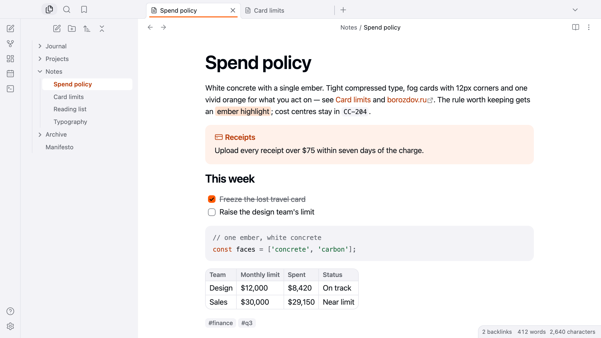
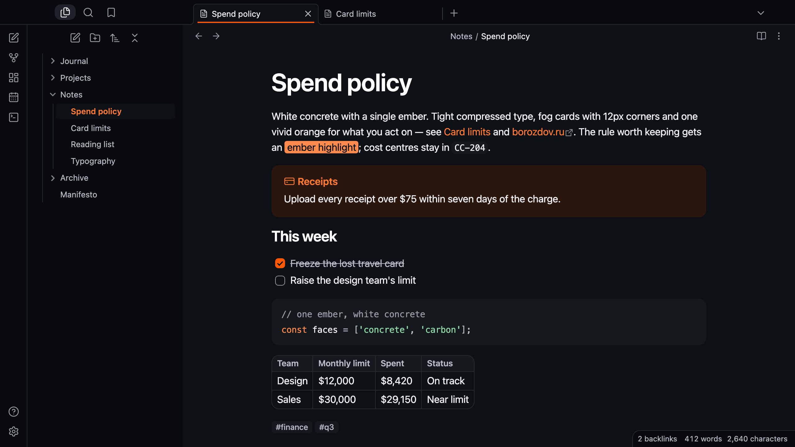

# Borozdov Flint

A theme from the Borozdov collection. Two faces — light **Concrete**, white concrete with a
single ember, and dark **Carbon**, the same workbench after the lights go out. Tight
compressed type, fog cards with 12px corners and one vivid orange for what you act on.

## Principles

- **One ember.** Vivid orange fills the main button, a checked task and the toggle and
  underlines the active tab; a deeper ember carries links and the open file; nothing else is
  coloured.
- **Compressed type.** The platform's sans tracked in at every size, headings at 600 tracked
  harder as they grow.
- **Concrete and fog.** White paper and cool fog cards, separated by tone rather than
  shadow, with mist hairlines.
- **Precise shapes.** 12px corners on cards, buttons and fields, 6px on tags.

## Features

- Light and dark modes, following Settings → Appearance → Base color scheme
- The active tab underlined in ember
- Callouts as fog cards with the title in the type's colour; the plain note on an ember wash
- An ember main button with blue-black type
- Quiet editing: no focus ring around the note, its title or form fields while you type;
  property names read as labels, not boxed fields
- Text colours meet WCAG contrast on both faces
- The phone layout keeps the same colours and shapes
- No embedded fonts, so the theme stays around 12 KB
- No `!important`: every rule can be overridden with a CSS snippet

## Installation

**From the community directory:** Settings → Appearance → Themes → Manage, search for
**Borozdov Flint**, then **Install and use**.

**By hand:** download `manifest.json` and `theme.css` from the [latest
release](https://github.com/borozdov-obsidian-themes/flint/releases/latest) into
`<vault>/.obsidian/themes/Borozdov Flint/`, then choose Borozdov Flint under Settings →
Appearance → Themes.

## License

MIT — see [LICENSE](LICENSE).

---

**По-русски.** Тема из коллекции Borozdov. Два лика: светлый «Бетон» — белый бетон с
единственной искрой, и тёмный «Углерод» — тот же верстак, когда гаснет свет. Плотный сжатый
шрифт, туманные карточки со скруглением 12px и один яркий оранжевый для того, что вы
делаете. Шрифты не встроены. Устанавливается из каталога: Настройки → Оформление → Темы →
Настроить → Borozdov Flint → Установить и применить.
